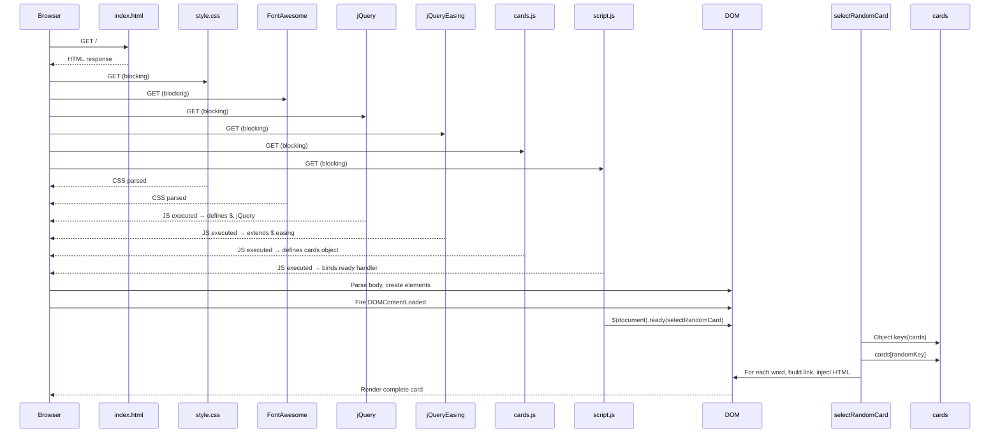

# Host and Composition Component

## Overview

This component describes the runtime hosting environment, resource loading composition, and the bootstrap sequence that assembles the application in the browser.

## Host Environment

### Primary Host: GitHub Pages

- **URL**: https://hmlendea.github.io/alias-cards-rou
- **Type**: Static site hosting
- **Protocol**: HTTPS only
- **Custom domain**: None (uses github.io subdomain)
- **Build process**: None — files served directly from repository `main` branch
- **Caching**: GitHub Pages default (typically 10 min max-age for HTML, longer for assets)

### Local Development Host

- **Method**: Open `index.html` directly in browser (`file://` protocol)
- **Limitations**:
  - CDN resources load over HTTPS (works)
  - NuciSearch links open in new tabs (works)
  - No service worker, no offline support
  - CORS not applicable (no fetch/XHR)

### Supported Browsers

Any modern browser with:
- ES5+ JavaScript support
- `Object.keys()`, `Array.prototype.forEach`
- `Math.random()`, `Math.floor()`
- `encodeURIComponent()`
- CSS Flexbox, `aspect-ratio`, `position: fixed`
- `querySelector`, `classList` (via jQuery)

Tested: Chrome, Firefox, Safari, Edge (current versions)

## Resource Loading Composition

### Load Order (from `index.html`)

```html
<head>
  <link rel="stylesheet" href="style.css">                    <!-- 1. Local CSS -->
  <link rel="stylesheet" href="...font-awesome...css">        <!-- 2. Font Awesome CSS -->
  <script src="...jquery...js"></script>                      <!-- 3. jQuery -->
  <script src="...jquery-easing...js"></script>               <!-- 4. jQuery Easing -->
  <script src="cards.js"></script>                            <!-- 5. Card data -->
  <script src="script.js"></script>                           <!-- 6. Application logic -->
</head>
```

### Dependency Graph

```
index.html
├── style.css (local, blocking)
├── Font Awesome CSS (CDN, blocking)
├── jQuery (CDN, blocking)
│   └── jQuery Easing (CDN, blocking, extends jQuery)
├── cards.js (local, blocking)
│   └── Defines global `cards` object
└── script.js (local, blocking)
    ├── Requires: jQuery ($)
    ├── Requires: global `cards`
    └── Executes: $(document).ready(selectRandomCard)
```

### Blocking Behaviour

All `<script>` and `<link rel="stylesheet">` in `<head>` are **render-blocking**. Page remains blank until:
1. `style.css` loads
2. Font Awesome CSS loads
3. jQuery loads and executes
4. jQuery Easing loads and executes
5. `cards.js` loads and executes (defines `cards`)
6. `script.js` loads and executes (binds ready handler)

**Total blocking resources**: 6 (2 local, 4 CDN)

### Global Namespace Pollution

| Global | Source | Purpose |
|--------|--------|---------|
| `$` / `jQuery` | jQuery CDN | DOM library |
| `jQuery.easing` | jQuery Easing CDN | Animation extensions |
| `cards` | `cards.js` | Card catalogue (200 cards) |
| `selectRandomCard` | `script.js` | Primary controller function |

No module system (ESM, CommonJS, AMD) — all globals.

## Bootstrap Sequence



### Timing Characteristics

| Phase | Typical Duration | Notes |
|-------|------------------|-------|
| DNS + TCP + TLS (CDN) | 50–200 ms | 3 CDN hosts (cdnjs.cloudflare.com) |
| Resource download | 10–50 ms each | ~100 KB total |
| JS parse + execute | 5–15 ms | Small scripts |
| DOM construction | 5–10 ms | 8 word elements + button + links |
| First card render | < 5 ms | Synchronous DOM updates |
| **Total to interactive** | **100–400 ms** | Depends on CDN latency |

## Composition Concerns

### CDN Single Point of Failure

All 3 external libraries come from `cdnjs.cloudflare.com`:
- jQuery 3.6.3
- jQuery Easing 1.12.1
- Font Awesome 6.5.1

**Failure mode**: If CDN unavailable, application fails to initialise (no card rendering, no button handler).

**Mitigation options** (not implemented):
- Local fallback copies
- Service worker caching
- Multiple CDN sources

### No Build Step

- No bundling, minification, transpilation
- No hash-based cache busting
- No tree-shaking (jQuery Easing unused)
- Direct source deployment

### Version Pinning

All CDN URLs use exact versions:
- `jquery/3.6.3/jquery.min.js`
- `jquery-easing/1.12.1/jquery.easing.min.js`
- `font-awesome/6.5.1/css/all.min.js`

No automatic updates — manual version bump required.

## Runtime Composition

After bootstrap, the composed application consists of:

```
Window
├── Global: $, jQuery, jQuery.easing, cards, selectRandomCard
├── DOM:
│   ├── .card (container)
│   │   ├── #word1 .word → .word-number + .word-text (anchor)
│   │   ├── ...
│   │   └── #word8 .word → .word-number + .word-text (anchor)
│   ├── .github-link (fixed)
│   ├── .donate-link (fixed)
│   └── #next-button (fixed)
└── Event Listeners:
    └── #next-button: click → selectRandomCard()
```

No background timers, no Web Workers, no persistent connections.

## Self-Hosting Composition

To self-host completely (no external dependencies):

1. **Download locally**:
   - `jquery-3.6.3.min.js`
   - `jquery.easing-1.12.1.min.js`
   - `font-awesome-6.5.1` (CSS + webfonts)

2. **Update `index.html`**:
   ```html
   <link rel="stylesheet" href="font-awesome/css/all.min.css">
   <script src="jquery-3.6.3.min.js"></script>
   <script src="jquery.easing-1.12.1.min.js"></script>
   ```

3. **Serve via any static HTTP server** (nginx, Apache, Caddy, Python `http.server`, etc.)

4. **Optional**: Replace NuciSearch with local search or alternative provider in `script.js`

## Extension Points

1. **Add build step**: Introduce Vite, esbuild, or Webpack for bundling/minification
2. **Module migration**: Convert to ES modules (`type="module"`, `import`/`export`)
3. **CDN fallback**: Add local copies with `onerror` fallback logic
4. **Service worker**: Add offline support with Workbox
5. **CSP header**: Add Content-Security-Policy when served via HTTP server