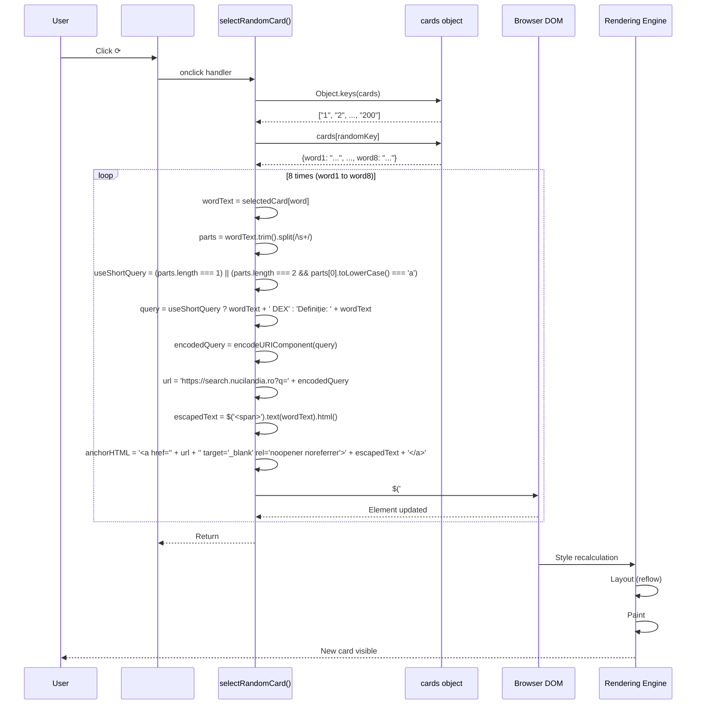

# Detail Mutation Flow

## Overview

This flow describes how the DOM is mutated during a card draw — the precise sequence of element updates, content replacement, and browser rendering.

## Mutation Sequence



## Per-Word Mutation Detail

For each `word` in `["word1", "word2", ..., "word8"]`:

### Before Mutation

```html
<div id="word3" class="word">
  <span class="word-number">3</span>
  <span class="word-text">
    <a href="https://search.nucilandia.ro?q=previous%20query" target="_blank" rel="noopener noreferrer">previous word</a>
  </span>
</div>
```

### Mutation Operation

```javascript
$('#word3 .word-text').html(newAnchorHTML)
```

### After Mutation

```html
<div id="word3" class="word">
  <span class="word-number">3</span>
  <span class="word-text">
    <a href="https://search.nucilandia.ro?q=new%20query" target="_blank" rel="noopener noreferrer">new word</a>
  </span>
</div>
```

### What Changes

| Element | Before | After |
|---------|--------|-------|
| `#word3 .word-text` content | Old anchor | New anchor |
| Anchor `href` | Old NuciSearch URL | New NuciSearch URL |
| Anchor text | Old word | New word |
| `.word-number` | Unchanged (static) | Unchanged |
| `#word3` wrapper | Unchanged | Unchanged |

### What Stays Constant

- `.word-number` span (1–8) — never modified
- `#wordN` container divs — never recreated
- `.card` container — never recreated
- Button and external links — never modified

## Browser Rendering Pipeline

### Trigger

- 8 calls to `.html()` in same synchronous execution context
- Browser batches DOM mutations

### Style Recalculation

- Changed: `.word-text` content (text + link)
- Unchanged: Layout-affecting properties (width, height, position)
- **Result**: Minimal style recalc — only text/content styles

### Layout (Reflow)

- **No layout trigger** — `.word-text` uses `flex-grow: 1`, anchor is inline
- Text length change may cause line wrapping within fixed-height `.word`
- **Impact**: Contained to `.word-text` box, no ancestor relayout

### Paint

- Repaints: 8 `.word-text` regions + anchor text
- **Area**: Small (word text regions only)
- **Layers**: No compositing layer changes

### Composite

- No layer changes — standard document flow

## Mutation Invariants

1. **Exactly 8 mutations** per draw (one per word slot)
2. **Same 8 target elements** every time (`#word1 .word-text` through `#word8 .word-text`)
3. **No element creation/destruction** — only content replacement
4. **No attribute changes** on containers — only innerHTML of `.word-text`
5. **Synchronous completion** — all 8 done before function returns
6. **No intermediate states visible** — browser paints once after all mutations

## Memory Behaviour

### Allocations Per Draw

| Allocation | Count | Lifetime |
|------------|-------|----------|
| `keys` array | 1 (200 strings) | Function scope, GC after return |
| `randomKey` string | 1 | Function scope |
| `selectedCard` reference | 1 | Function scope |
| Loop variables (`word`, `wordText`, `parts`, `query`, `encodedQuery`, `url`, `escapedText`, `anchorHTML`) | 8 × 8 = 64 | Per iteration, GC after loop |
| jQuery objects (`$('<span>')`, `$('#wordN .word-text')`) | 8 × 2 = 16 | Per iteration, GC after loop |
| Old anchor elements | 8 | Detached, GC after paint |

### Garbage Collection

- All temporary objects eligible for GC after `selectRandomCard()` returns
- No closures retaining references
- No memory leak across draws

## Performance Characteristics

| Metric | Value |
|--------|-------|
| JS execution time | < 1 ms |
| DOM mutations | 8 |
| Style recalc | Minimal |
| Layout | None/Minimal |
| Paint area | ~8 × word-text boxes |
| Frame budget impact | Negligible (< 16 ms) |

## Edge Cases

| Edge Case | Behaviour |
|-----------|-----------|
| Word text contains HTML | Escaped by `$('<span>').text()` — safe |
| Word text contains quotes | Escaped — safe in attribute |
| Word text very long | Anchor wraps within `.word-text` (flex-grow) |
| Word text empty | Empty anchor (unlikely — no empty cards) |
| Rapid clicks | Sequential execution, last draw wins visually |
| Cards object modified externally | Not possible (no external access) |

## Debugging Mutations

### DevTools Breakpoints

1. **DOM breakpoint**: Right-click `#word1 .word-text` → Break on → Subtree modifications
2. **JS breakpoint**: Line `$('#' + word + ' .word-text').html(anchorHTML)` in `script.js`
3. **Paint flashing**: DevTools → Rendering → Paint flashing — observe repaint regions

### Console Inspection

```javascript
// Current card key (not directly accessible, but can infer)
document.querySelector('#word1 .word-text a').href
// → "https://search.nucilandia.ro?q=..."
// Parse q parameter to see query

// All word texts
Array.from(document.querySelectorAll('.word-text a')).map(a => a.textContent)
// → ["word1", "word2", ..., "word8"]
```