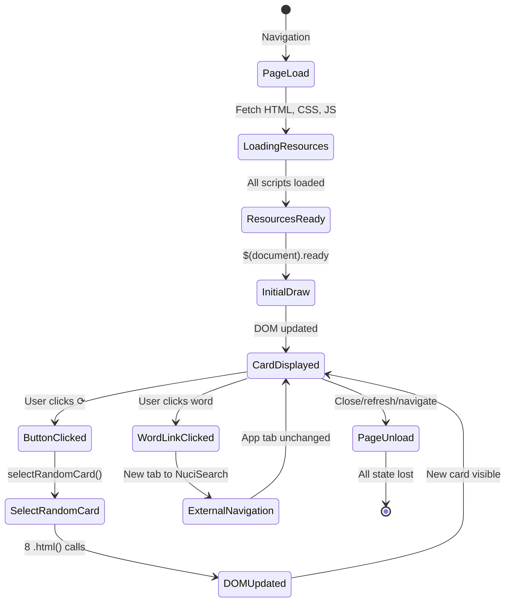

# State and Persistence

## Overview

The Alias Cards application is **stateless** by design. It maintains no persistent state, no session state, and no user data. All state is ephemeral and exists only in the DOM during a single page session.

## State Classification

| State Type | Exists? | Location | Lifetime |
|------------|---------|----------|----------|
| **Persistent** (localStorage, IndexedDB, cookies) | ❌ No | — | — |
| **Session** (sessionStorage, in-memory across draws) | ❌ No | — | — |
| **Ephemeral DOM** (current card display) | ✅ Yes | 8 `.word-text` elements | Page session |
| **Ephemeral JS** (variables in `selectRandomCard`) | ✅ Yes | Function scope | Function execution |
| **Global JS** (`cards` catalogue) | ✅ Yes | `window.cards` | Page session |
| **URL/History** | ❌ No | — | — |

## Ephemeral DOM State

### Current Card Display

```html
<!-- 8 word slots, each with: -->
<div id="word1" class="word">
  <span class="word-number">1</span>
  <span class="word-text">
    <a href="https://search.nucilandia.ro?q=..." target="_blank" rel="noopener noreferrer">
      kilometru
    </a>
  </span>
</div>
<!-- ... word2 through word8 ... -->
```

### State Transitions

```
Page Load          Button Click          Button Click
     │                  │                    │
     ▼                  ▼                    ▼
┌─────────┐        ┌─────────┐          ┌─────────┐
│ Empty   │  ──►   │ Card A  │   ──►    │ Card B  │
│ (initial)       │ (8 words)           │ (8 words)│
└─────────┘        └─────────┘          └─────────┘
     │                  │                    │
     │         replace  │            replace  │
     │         innerHTML│            innerHTML│
     ▼                  ▼                    ▼
```

### Mutation Operations

| Operation | Trigger | DOM Changes |
|-----------|---------|-------------|
| Initial render | `$(document).ready` | 8 `.html()` calls |
| Redraw | Button click | 8 `.html()` calls |
| No "clear" state | — | Never explicitly cleared |

## Ephemeral JavaScript State

### Global: `cards` Catalogue

```javascript
// Loaded from cards.js, immutable after load
window.cards = {
  "1": {word1: "...", ..., word8: "..."},
  ...
  "200": {word1: "...", ..., word8: "..."}
};

// Size: ~80 KB, 200 keys, 1600 word strings
// Lifetime: Page session (lost on refresh/navigation)
```

### Function Scope: `selectRandomCard()`

```javascript
function selectRandomCard() {
  // All variables below: created per call, GC after return
  const keys = Object.keys(cards);           // string[200]
  const randomKey = keys[Math.floor(Math.random() * keys.length)]; // string
  const selectedCard = cards[randomKey];     // WordSlot object

  for (let i = 1; i <= 8; i++) {
    const wordKey = 'word' + i;              // string
    const wordText = selectedCard[wordKey];  // string
    const parts = wordText.trim().split(/\s+/); // string[]
    const useShortQuery = ...;               // boolean
    const query = ...;                       // string
    const encodedQuery = encodeURIComponent(query); // string
    const url = 'https://search.nucilandia.ro?q=' + encodedQuery; // string
    const escapedText = $('<span>').text(wordText).html(); // string
    const anchorHTML = '<a href="' + url + '" target="_blank" rel="noopener noreferrer">' + escapedText + '</a>'; // string
    $('#' + wordKey + ' .word-text').html(anchorHTML); // DOM mutation
  }
  // All variables eligible for GC here
}
```

## No Persistence Mechanisms

### localStorage

```javascript
// Not used
localStorage.setItem('lastCard', '42');  // Never called
localStorage.getItem('lastCard');        // Never called
```

### sessionStorage

```javascript
// Not used
sessionStorage.setItem('drawCount', '5'); // Never called
```

### Cookies

```javascript
// Not used
document.cookie = 'pref=dark'; // Never set
```

### IndexedDB

```javascript
// Not used
// No database operations
```

### Cache API / Service Worker

```javascript
// Not used
// No offline support
```

### URL State

```javascript
// Not used
// No history.pushState, no hash routing
// Refresh = new random card (no deep linking)
```

## State Diagram



## Data Flow (No Persistence)

```
┌─────────────┐     ┌─────────────┐     ┌─────────────┐
│  cards.js   │────►│ window.cards│────►│ selectRandom│
│  (static)   │     │  (memory)   │     │   Card()    │
└─────────────┘     └─────────────┘     └──────┬──────┘
                                               │
                                               ▼
                                        ┌─────────────┐
                                        │    DOM      │
                                        │ (ephemeral) │
                                        └─────────────┘
                                               │
                                               ▼
                                        ┌─────────────┐
                                        │  User View  │
                                        └─────────────┘
```

## Implications

### Positive

| Benefit | Description |
|---------|-------------|
| **Zero privacy risk** | No personal data stored or transmitted |
| **Zero storage quota** | No localStorage/IndexedDB limits |
| **Zero sync complexity** | No multi-tab, multi-device concerns |
| **Zero migration** | No schema versioning, no data migration |
| **Instant reset** | Refresh = clean slate |
| **No corruption** | No persistent state to corrupt |
| **Simple debugging** | State = current DOM only |

### Negative

| Limitation | Description |
|------------|-------------|
| **No history** | Cannot "go back" to previous card |
| **No favourites** | Cannot save cards/words |
| **No progress** | No streak, count, statistics |
| **No preferences** | No theme, language, difficulty settings |
| **No offline** | Requires network for initial load |
| **No personalization** | Same experience for all users |

## If Persistence Were Added

### localStorage (Simple)

```javascript
// Save last drawn card
function saveLastCard(cardId) {
  localStorage.setItem('aliasCards.lastCardId', cardId);
}

// Restore on load
function restoreLastCard() {
  const cardId = localStorage.getItem('aliasCards.lastCardId');
  if (cardId && cards[cardId]) {
    renderCard(cards[cardId]);
    return true;
  }
  return false;
}
```

### IndexedDB (Full History)

```javascript
// Store draw history
const db = await openDB('alias-cards', 1, {
  upgrade(db) {
    db.createObjectStore('draws', { keyPath: 'id', autoIncrement: true });
  }
});

async function recordDraw(cardId, words) {
  await db.add('draws', { cardId, words, timestamp: Date.now() });
}

async function getHistory(limit = 50) {
  return db.getAllFromIndex('draws', 'timestamp', IDBKeyRange.upperBound(Date.now()), limit);
}
```

### Sync Across Tabs (BroadcastChannel)

```javascript
const channel = new BroadcastChannel('alias-cards-sync');

channel.onmessage = (event) => {
  if (event.data.type === 'card-drawn') {
    renderCard(event.data.card);
  }
};

function selectRandomCard() {
  // ... existing logic ...
  channel.postMessage({ type: 'card-drawn', card: selectedCard });
}
```

## Current State Verification

### Check No Persistence Used

```javascript
// Run in console - should all be empty/undefined
console.log('localStorage:', Object.keys(localStorage));
console.log('sessionStorage:', Object.keys(sessionStorage));
console.log('cookies:', document.cookie);
console.log('indexedDB:', indexedDB.databases ? await indexedDB.databases() : 'N/A');
```

### Check Ephemeral State Only

```javascript
// Current card from DOM
const currentCard = Array.from(document.querySelectorAll('.word-text a')).map(a => a.textContent);
console.log('Current card:', currentCard);

// Global catalogue
console.log('Catalogue size:', Object.keys(cards).length);
```

## Summary

| Aspect | Status |
|--------|--------|
| Persistent storage | ❌ None |
| Session storage | ❌ None |
| Cookies | ❌ None |
| IndexedDB | ❌ None |
| Service Worker | ❌ None |
| URL routing | ❌ None |
| Ephemeral DOM state | ✅ 8 word slots |
| Ephemeral JS state | ✅ Function scope |
| Global JS state | ✅ `cards` catalogue |
| State on refresh | 🔄 Lost (new random card) |
| State on navigation | 🔄 Lost |
| State on close | 🔄 Lost |

**Design decision**: Statelessness is intentional for simplicity, privacy, and zero maintenance.